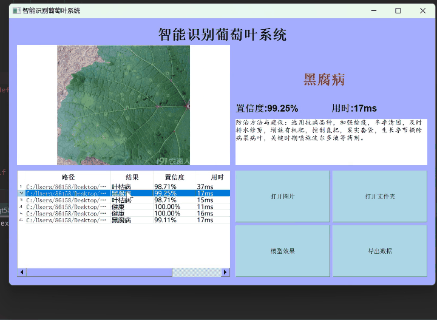
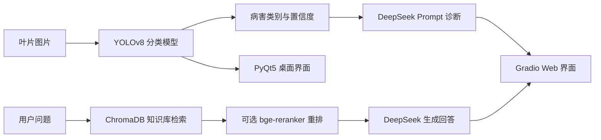

# 葡萄叶片病害智能识别与诊断系统

基于 YOLOv8、DeepSeek 大语言模型与 RAG 知识库的葡萄叶片病害识别系统。项目包含桌面端批量识别、Web 端智能诊断、知识库问答和三组可复现实验。



上图展示的是 PyQt5 桌面端识别流程。**RAG 知识问答位于 Gradio Web 端第二个 Tab**，需要先构建知识库后运行 `毕设系统/app_gradio.py`。

## 功能概览

- 葡萄叶片图像识别：黑腐病、黑麻疹、叶枯病、健康 4 类
- PyQt5 桌面端：单张/文件夹批量识别、结果表格、CSV 导出、训练曲线展示
- Gradio Web 端：图像识别后由 DeepSeek 生成结构化诊断建议
- RAG 知识问答：ChromaDB 向量检索 + bge 中文 Embedding + 可选重排
- 实验评测：检索配置对比、纯 LLM / 基础 RAG / 优化 RAG 对比、模型消融

## 系统架构



## 项目结构

```text
grape-leaf-disease-recognition/
├─ pyqt5界面.py                 # PyQt5 桌面端入口
├─ docs/                        # README 演示图
├─ 毕设系统/
│  ├─ app_gradio.py             # Gradio Web 端入口
│  ├─ config.py                 # 路径、模型与 LLM 配置
│  ├─ llm_diagnosis.py          # DeepSeek 诊断与 Prompt 版本管理
│  ├─ rag_module.py             # RAG 检索、重排与回答生成
│  ├─ kb_builder.py             # 知识库分块与向量入库
│  ├─ eval_set.json             # 20 条人工整理评测问题
│  ├─ exp1_rag_compare.py       # 分块长度 / Top-K / 重排对比
│  ├─ exp2_answer_quality.py    # 纯 LLM、基础 RAG、优化 RAG 对比
│  ├─ exp3_model_ablation.py    # YOLOv8 模型消融评测
│  └─ 知识库/                   # 葡萄病害防治语料
├─ requirements.txt
└─ .env.example
```

## 快速开始

### 1. 安装环境

建议使用 Python 3.10：

```bash
git clone https://github.com/yulianstarfish/grape-leaf-disease-recognition.git
cd grape-leaf-disease-recognition
python -m venv .venv
.venv\Scripts\activate
pip install -r requirements.txt
```

### 2. 准备模型与密钥

1. 将训练好的 `best.pt` 放在项目根目录。模型权重较大，不包含在 Git 仓库中。
2. 进入 `毕设系统` 目录，将 `.env.example` 复制为 `.env`。
3. 在 `.env` 中填写：

```text
DEEPSEEK_API_KEY=sk-你的key
```

### 3. 运行桌面端

```bash
python pyqt5界面.py
```

桌面端支持：

- 打开单张叶片图片识别
- 打开文件夹批量识别
- 查看识别类别、置信度和耗时
- 导出识别记录 CSV
- 读取训练 `results.csv` 并展示训练准确率曲线

### 4. 运行 Web 端

首次使用 RAG 知识库前，先构建向量库。首次运行会自动下载 bge 中文 Embedding 模型：

```bash
cd 毕设系统
python kb_builder.py
python app_gradio.py
```

浏览器访问 `http://127.0.0.1:7860`。

启动后页面包含两个 Tab：

1. **图像诊断**：上传叶片图片，YOLOv8 识别后由 DeepSeek 生成结构化诊断建议。
2. **知识库问答**：输入病虫害问题，通过 RAG 检索知识库并生成带资料依据的回答。

## 实验复现

### 实验 1：RAG 检索配置对比

对比 256 / 512 / 1024 分块长度、Top-3 / Top-5 / Top-8、是否使用 bge-reranker，共 18 组配置：

```bash
cd 毕设系统
python exp1_rag_compare.py
```

快速试跑可减少评测集数量：

```bash
python exp1_rag_compare.py --limit 5
```

### 实验 2：回答质量对比

对比纯 LLM、基础 RAG、优化 RAG 三种方案，并生成自动评分与人工盲评表格：

```bash
python exp2_answer_quality.py
```

### 实验 3：模型消融

先在 `config.py` 中填写 Ultralytics 格式的数据集配置 `DATA_YAML`，如需对比 YOLOv8s，再填写 `YOLO_MODEL_S`：

```bash
python exp3_model_ablation.py
```

实验结果默认输出到 `毕设系统/实验结果/`，该目录不提交到 Git。

## 数据与隐私说明

- `best.pt`、`grapes images/` 数据集和 ChromaDB 向量库不包含在仓库中。
- `.env` 不包含在仓库中，请通过 `.env.example` 配置 API Key。
- 公开仓库不包含课程文档、演示视频等个人或大体积文件。

## 当前限制

- 分类结果依赖训练数据分布，复杂背景、遮挡和水珠反光会降低置信度。
- LLM 诊断建议不能替代农业专家意见，低置信度结果需要人工复核。
- RAG 回答质量受知识库覆盖范围影响，当前语料以葡萄常见病害防治为主。
- 模型精度、mAP、FPS 等指标需在配置数据集后通过实验 3 重新评测。

## 技术栈

YOLOv8 / PyQt5 / Gradio / DeepSeek API / ChromaDB / Sentence Transformers / bge-reranker / Pandas / Matplotlib
